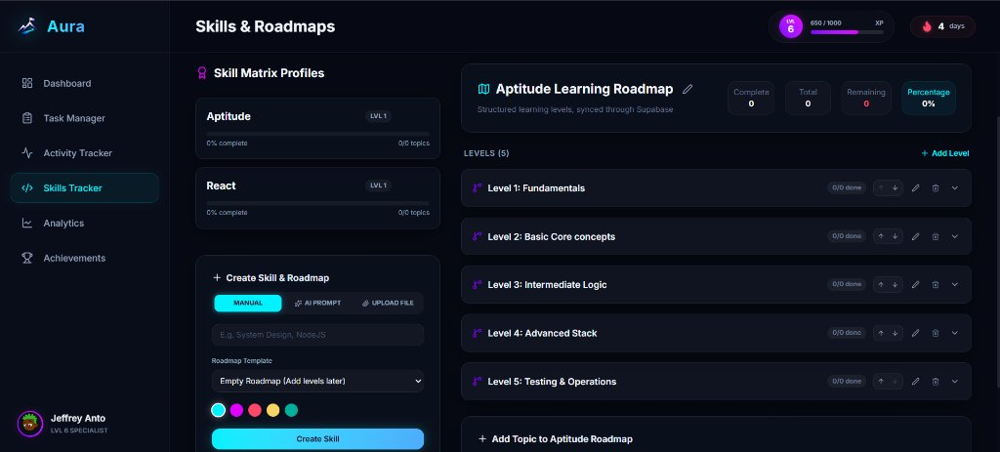
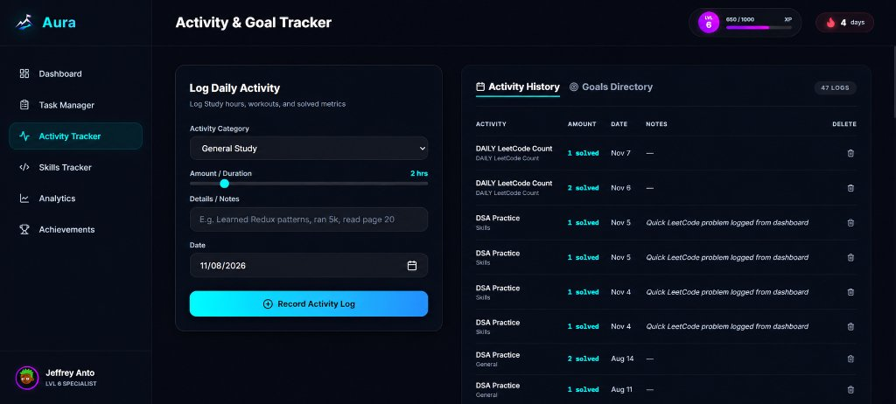
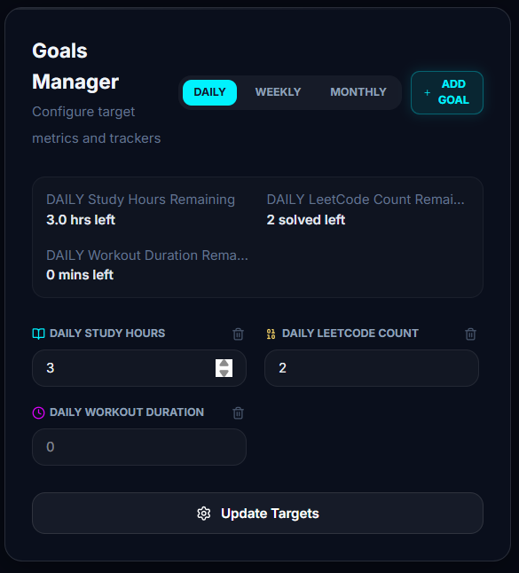
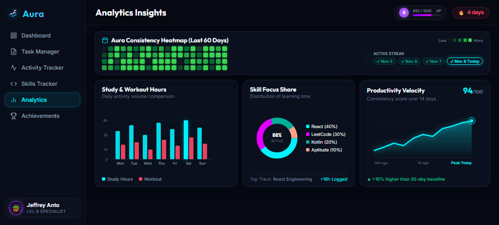
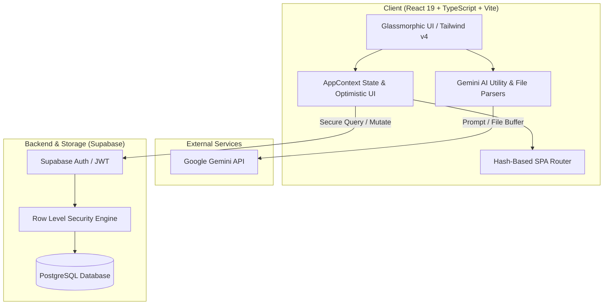

<div align="center">

  

  # Aura — Personal Analytics Operating System

  **The Intelligent Productivity & Learning Cockpit for Developers, Engineers, and High-Performers.**

  <br />

  [](https://jf-aura-tracker.vercel.app/)
  [](https://react.dev/)
  [](https://www.typescriptlang.org/)
  [](https://tailwindcss.com/)
  [](https://vitejs.dev/)
  [](https://supabase.com/)
  [](https://ai.google.dev/)
  [](https://opensource.org/licenses/MIT)

  <p align="center">
    <a href="https://jf-aura-tracker.vercel.app/" target="_blank"><b>🌐 View Live Application</b></a> •
    <a href="#-core-features">Core Features</a> •
    <a href="#-system-architecture">Architecture</a> •
    <a href="#-screenshots--ui-walkthrough">Screenshots</a> •
    <a href="#-tech-stack">Tech Stack</a> •
    <a href="#-database-schema--security">Database Schema</a> •
    <a href="#-getting-started">Getting Started</a> •
    <a href="#-author--connect">Author</a>
  </p>

</div>

---

## 🚀 Live Deployment
The application is live and deployed on Vercel:  
👉 **[https://jf-aura-tracker.vercel.app/](https://jf-aura-tracker.vercel.app/)**

---

## 📌 Executive Summary

**Aura** is a full-stack, enterprise-grade Personal Analytics Operating System engineered to eliminate context switching and streamline self-directed engineering mastery. 

Unlike traditional to-do apps or generic habit trackers, Aura integrates **generative AI intelligence**, **real-time PostgreSQL synchronization**, **multi-period goal quantification**, and a **gamified skill-tree progression system** into a high-performance, dark-glass reactive dashboard.

---

## 📸 Screenshots & UI Walkthrough

### 1. Skills Matrix & AI-Generated Roadmaps
*Structured curriculum levels, real-time topic progress tracking, and AI-powered roadmap synthesis via text prompt or document upload.*

<div align="center">
  
</div>

<br />

### 2. Activity Tracking & Dynamic Goals Management
*Log daily focus sessions with precision duration sliders, automatically sync custom categories, and configure unbounded, multi-frequency daily, weekly, and monthly target metrics.*

<div align="center">
  
</div>

<div align="center">
  
  <p><sub><i>Dynamic Goals Manager with unlimited goals, customizable target units, and delete safeguards</i></sub></p>
</div>

<br />

### 3. Analytics Insights & Behavioral Charts
*60-day consistency heatmap, dual-bar study vs. workout volume charts, skill focus share distribution donut, and 14-day productivity velocity progression curve.*

<div align="center">
  
</div>

---

## 🚀 Core Features & Engineering Highlights

### 📊 1. Analytics Engine & Interactive Data Visualizations
- **60-Day Consistency Heatmap**: Visual contribution density map showing consistency across all habits with real-time level color coding.
- **Active Streak Timeline**: 15-day granular history displaying active grind status with teal verification markers.
- **Study & Workout Volume Bar Chart**: Recharts-powered dual-bar visualization tracking daily study hours against physical workouts with custom tooltips.
- **Skill Focus Share Donut**: Proportional distribution of time and topics checked across active roadmap paths (React, DSA, Kotlin, Aptitude).
- **Productivity Velocity Trend**: Glowing area chart calculating consistency scores over 14-day rolling intervals with peak performance tracking.
- **Predictive Velocity Forecasting**: Estimates target completion dates for ongoing skills and roadmaps based on 14-day rolling averages.

### 🤖 2. Gemini AI Document & Roadmap Intelligence
- **Document-to-Checklist Pipeline**: Upload any project document, syllabus, or PDF. Aura extracts the content and triggers Google Gemini to generate ordered, actionable sub-task checklists directly into task cards.
- **AI Prompt-to-Roadmap Generation**: Type any skill (e.g., *"Kotlin Android App Development"*), and the Gemini AI synthesizes a multi-level roadmap with structured topics, milestones, and preview confirmation before database persistence.
- **Client-Safe Fallback**: Includes local algorithmic fallback parsers ensuring zero interruption if external API quotas are exceeded.

### 🎯 3. Dynamic Scalable Goal Management
- **Unbounded Multi-Period Goals**: Replaced legacy fixed schemas with a dynamic, user-scoped relational `goals` architecture. Users can add, edit, archive, and delete an arbitrary number of goals.
- **Automated Dropdown Sync**: Adding any goal automatically maps the category directly into the Activity Logger dropdown for friction-free metric tracking.
- **Visual Completion Gauges**: Real-time progress bars calculating percentage thresholds against daily, weekly, and monthly targets.

### 🔄 4. Smart Recurring Tasks & History Analytics
- **Daily Auto-Reset Engine**: Tasks marked as *“repeats daily”* automatically reset completion statuses and sub-checklists at 00:00 local time without manual re-entry.
- **Historical Retention & Streaks**: Preserves an immutable log of daily recurring task completions stored as structured JSON arrays, preventing data overwrite.
- **Dedicated Recurring Analytics**: Tracks daily completion velocity and recurring task streaks over time.

### ⚡ 5. Customizable Dashboard Shortcuts
- **Modular Quick-Action Bar**: Dashboard shortcuts can be customized, reordered, added, or removed (enforcing a minimum of 1 active shortcut).
- **Persistent Preferences**: Shortcut order and selections persist seamlessly across sessions per user in Supabase and local storage.
- **Instant Actions**: One-click shortcuts for rapid logging (e.g. `+1h Study`, `+30m Workout`) and deep navigation to sub-modules.

### 🎮 6. Gamification & Progression System
- **Leveling & XP Engine**: Every tracked activity, completed checklist item, and reached milestone awards dynamic XP.
- **Achievement Showcase**: Visual rank badges (e.g., *“Deep Worker”*, *“Code Marathoner”*) unlocked through consistent streaks and learning volume.
- **Celebration Modals**: Framer Motion animated overlay effects celebrating level-ups and unlocked achievements.

---

## 🏗 System Architecture



---

## 💻 Tech Stack & Design Choices

| Layer | Technology | Architectural Rationale |
|---|---|---|
| **Framework** | **React 19** + **TypeScript** | Strict type safety, clean component lifecycle, modern concurrent rendering features. |
| **Bundler & Tooling** | **Vite 6** + **ESLint** | Instant HMR development cycles, tree-shaking, sub-2s production builds. |
| **Styling** | **Tailwind CSS v4** | Modern theme variables, hardware-accelerated glassmorphism, dynamic theme switches. |
| **Motion** | **Framer Motion 12** | Physics-based spring animations, layout transitions, and celebration modal overlays. |
| **Charts** | **Recharts 3** | SVG-based responsive data visualizations, tooltips, and streak velocity graphs. |
| **Backend / DB** | **Supabase (PostgreSQL)** | Relational schemas, real-time sync, Row-Level Security (RLS), and JWT auth. |
| **AI Integration** | **Google Gemini 2.5/1.5** | Multi-modal reasoning for PDF text digestion and structured JSON roadmap synthesis. |

---

## 🔒 Database Schema & Security Architecture

Aura enforces **Zero-Trust Data Isolation** via PostgreSQL Row-Level Security (RLS). Every query is strictly authenticated through user-specific JWTs:

```sql
-- Security Policy Sample: Ensure users only access their personal goals
CREATE POLICY "Users can manage their own goals" 
ON public.goals 
FOR ALL 
USING (auth.uid() = user_id)
WITH CHECK (auth.uid() = user_id);
```

### Relational Tables
- `profiles`: User biography, avatar seed, cumulative XP, and rank level.
- `goals`: Dynamic user goals, target values, frequencies (`daily` / `weekly` / `monthly`), and units.
- `tasks`: Task catalog with priority, due date, recurring flags, checklist JSON, and completion history.
- `logs`: Immutable daily activity records with category, duration, date, and awarded XP.
- `skills`: Skill matrix records linked with slug identifiers, color themes, and levels.
- `skill_levels`: Tiered milestone levels for custom roadmaps.
- `roadmap_topics`: Granular checklist topics nested under specific skill levels.
- `badges` & `milestones`: Gamification targets and unlock criteria.

---

## ⚡ Getting Started & Local Development

### Prerequisites
- **Node.js**: v18+ (tested on Node 20 / 22 / 24)
- **npm** or **pnpm**
- A free **Supabase** project
- (Optional) A **Google Gemini API Key** for AI features

### Installation Steps

1. **Clone the repository:**
   ```bash
   git clone https://github.com/Jeffrey-Anto/Aura-Tracker.git
   cd Aura-Tracker
   ```

2. **Install dependencies:**
   ```bash
   npm install
   ```

3. **Configure Environment Variables:**
   Create a `.env` file in the root directory (you can copy `.env.example`):
   ```env
   # Supabase Configuration
   VITE_SUPABASE_URL=https://your-project-id.supabase.co
   VITE_SUPABASE_ANON_KEY=your_supabase_anon_key

   # Gemini AI Configuration (for PDF checklists & AI roadmaps)
   VITE_GEMINI_API_KEY=your_google_gemini_api_key
   ```

4. **Initialize Database Schema:**
   - Open your Supabase SQL Editor.
   - Run the provided [`supabase_schema.sql`](supabase_schema.sql) and [`tasks_feature_migration.sql`](tasks_feature_migration.sql) scripts to generate all tables, triggers, and RLS policies.

5. **Start the local development server:**
   ```bash
   npm run dev
   ```
   Open `http://localhost:5173` to explore Aura.

6. **Build for Production:**
   ```bash
   npm run build
   ```
   Generates an optimized, tree-shaken static bundle in `dist/`.

---

## 📈 Performance & Quality Benchmarks

- **Zero-Error Strict TypeScript**: Compiled with `tsc -b` with 100% strict type safety and zero compile errors.
- **Lightweight Production Bundle**: Entire application bundles into **~1.6 MB total** (~324 KB gzipped JavaScript), ensuring near-instant First Contentful Paint (FCP).
- **Graceful Offline Mode**: Built-in mock data fallback enables comprehensive previewing even when offline or unconfigured.

---

## 👨‍💻 Author & Connect

**Jeffrey Anto Thomas**  
*Computer Science & Engineering Student*  
Government College of Engineering, Srirangam (GCE-S)

- **Live Application**: [https://jf-aura-tracker.vercel.app/](https://jf-aura-tracker.vercel.app/)
- **GitHub**: [@Jeffrey-Anto](https://github.com/Jeffrey-Anto)
- **Project Repository**: [Aura-Tracker](https://github.com/Jeffrey-Anto/Aura-Tracker)
- **Specialization**: Full-Stack Development, React/TypeScript Architecture, Intelligent Web Applications.

---

<div align="center">
  <sub>Designed & Developed with precision. <b>Track. Learn. Grow.</b></sub>
</div>
